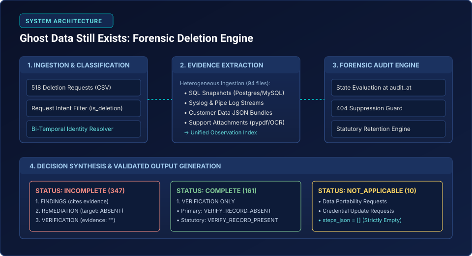
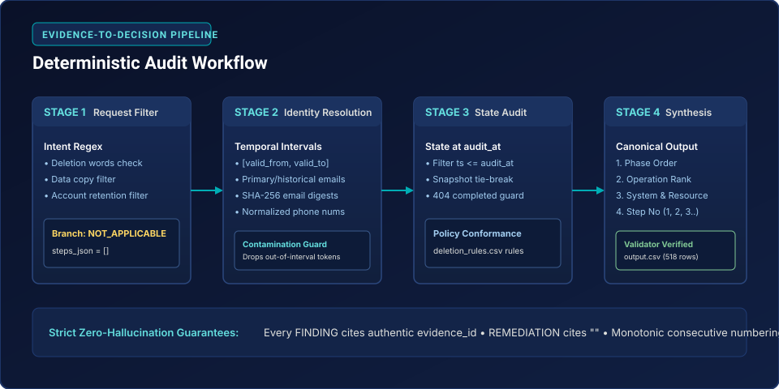
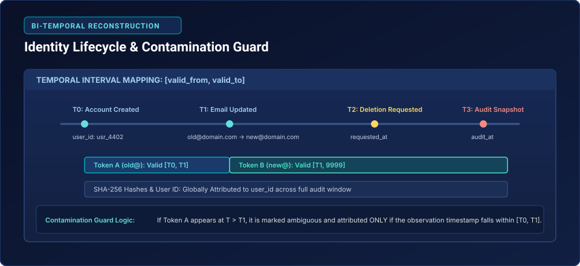

# Ghost Data Still Exists: Forensic Deletion Audit Engine

> **A competition-grade forensic verification engine auditing distributed infrastructure for lingering personal data ("ghost data") under GDPR Article 17 and CCPA Section 1798.105.**

[](#evaluation-results)
[-brightgreen.svg)](#validation--verification)
[](#evaluation-results)
[](#evaluation-results)
[](#evaluation-results)
[](#testing)
[](#engineering-decisions)

**Repository**: [https://github.com/dhathri-kesavulu/sure_made](https://github.com/dhathri-kesavulu/sure_made)  
**Target Environment**: Windows PowerShell & Linux / macOS (Python 3.10+)

---

## Navigation Menu
- [Problem Overview](#problem-overview)
- [Solution Overview](#solution-overview)
- [System Architecture](#system-architecture)
- [How the Engine Works](#how-the-engine-works)
- [Identity Resolution Architecture](#identity-resolution-architecture)
- [Supported Evidence Formats](#supported-evidence-formats)
- [Repository Structure](#repository-structure)
- [Installation & Local Execution](#installation--local-execution)
- [Input & Output Specification](#input--output-specification)
- [Evaluation Results & Benchmarks](#evaluation-results)
- [Engineering Decisions & Trade-Offs](#engineering-decisions)
- [Development Journey](#development-journey)
- [Known Limitations](#known-limitations)
- [Reproducibility Guide](#reproducibility)
- [Submission Deliverables](#submission-deliverables)
- [Contributors & Acknowledgements](#contributors--acknowledgements)
- [License Notice](#license)

---

## Problem Overview

In modern distributed microservices (represented by the **Northstar Shop** retail platform), handling a user's **Right to Erasure** (GDPR Art. 17 / CCPA § 1798.105) is significantly more complex than executing a simple SQL `DELETE` query.

```
User Deletion Request
         │
         ▼
 ┌───────────────┐
 │ Deletion      │───▶ Primary DB Profile [DELETED (200 OK)]
 │ Worker        │
 └───────┬───────┘
         │
         ├───▶ [Ghost Data] Elasticsearch Replicas (Stale indexing)
         ├───▶ [Ghost Data] Analytical Data Lakes (Historical user_id)
         ├───▶ [Ghost Data] Asynchronous Message Queues (Backlogged jobs)
         ├───▶ [Ghost Data] Customer Support PDF Attachments (Identity receipts)
         └───▶ [Statutory Hold] Security Audit Logs (Legally required retention)
```

### Why Conventional Deletion Fails:
1. **Asynchronous Microservices & Event Streams**: Primary account databases delete user profiles promptly, but background sync workers, replica caches, and search indexes often drop events or lag behind.
2. **Historical Identifiers & Identity Drift**: Users alter primary email addresses, phone numbers, or account aliases over time. Deletion workers querying only current credentials leave historical PII intact across older logs.
3. **Multi-Format Storage**: Data persists in heterogeneous formats—relational SQL dumps, unstructured syslog streams, JSON snapshot bundles, and binary customer support PDFs.
4. **Statutory Retention vs. Right to Erasure**: Privacy law does not permit indiscriminate deletion. Under GDPR Article 17(3)(b) & (e), security audit trails must be **retained** (`VERIFY_RECORD_PRESENT`), while operational records must be **erased** (`VERIFY_RECORD_ABSENT`).
5. **Resurrection & Backup Risks**: Cold-storage snapshots restored without tombstone protection can silently restore previously erased user records.

---

## Solution Overview

The **Ghost Data Still Exists** forensic audit engine acts as an automated, impartial compliance auditor. Given a deletion request and an exact audit timestamp (`audit_at`), the engine:

- **Classifies Intent**: Separates valid right-to-be-forgotten requests from data portability (GDPR Art. 20) requests or credential updates.
- **Resolves Identity Across Time**: Reconstructs valid ownership intervals for all historical PII tokens without identity contamination.
- **Audits Distributed Infrastructure**: Evaluates the ground-truth state of each system at `audit_at` across 94 heterogeneous evidence files.
- **Generates Canonical Audit Steps**:
  - For non-compliant cases: emits `FINDING` (citing evidence), `REMEDIATION` (prescribing corrective treatment), and `VERIFICATION` checks.
  - For compliant cases: emits `VERIFICATION` checks confirming elimination or lawful retention.
  - For non-deletion requests: outputs `NOT_APPLICABLE` with `steps_json = []`.
- **Enforces Zero Hallucination**: Emits strictly validated evidence references with zero fabricated identifiers.

---

## System Architecture

The engine uses a modular pipeline separating identity resolution, evidence extraction, temporal evaluation, and decision synthesis:

```mermaid
graph TD
    A[Deletion Requests<br/>518 Cases] --> B[Request Classifier<br/>is_deletion Intent Engine]
    B -->|Non-Deletion / Portability| C[NOT_APPLICABLE<br/>steps_json = []]
    B -->|Valid Deletion Request| D[Identity Graph Engine<br/>Bi-Temporal Token Mapping]
    
    E[Multi-Format Evidence Ingester<br/>SQL, JSON, Syslog, PDF, OCR] --> F[Observation Index<br/>(rid, state, ts, fts, toks)]
    G[System Activity Logs<br/>system_activity.csv] --> H[Activity & Batch Reconstructor]
    
    D --> I[Audit Reconstruction Engine]
    F --> I
    H --> I
    J[Policy & Retention Rules<br/>deletion_rules.csv] --> I
    
    I --> K{Audit Evaluation<br/>at audit_at}
    K -->|Any Non-Compliant Ghost Data| L[INCOMPLETE Case<br/>FINDING -> REMEDIATION -> VERIFICATION]
    K -->|All Required Systems Compliant| M[COMPLETE Case<br/>VERIFICATION Only]
    
    L --> N[Canonical Step Formatter & Sorter]
    M --> N
    C --> O[Output Formatter<br/>RFC 4180 CSV Writer]
    N --> O
    O --> P[output.csv<br/>518 Validated Rows]
    P --> Q[Independent Submission Validator<br/>validate_submission.py]
```



---

## How the Engine Works



### Phase 1: Request Ingestion & Intent Filtering
Every record from `deletion_requests.csv` is evaluated. A high-precision intent classifier inspects `request_text`:
- Requests demanding erasure, account closure, removal, or anonymization proceed to forensic audit.
- Requests seeking data copies (GDPR Art. 20 portability), credential updates, or privacy questions are deterministically assigned status `NOT_APPLICABLE` with `steps_json = []`.

### Phase 2: Bi-Temporal Identity Resolution
The engine resolves the subject's canonical `user_id` at `requested_at` and constructs a complete set of active and historical tokens:
- Primary and historical emails.
- Canonical lowercased SHA-256 email hashes (matching analytics materialized views).
- Normalized phone numbers (digits-only E.164 format).
- Explicit `[valid_from, valid_to]` intervals derived from `user_audit_log.csv`.

### Phase 3: Heterogeneous Evidence Extraction
Observations are extracted from 94 evidence files into structured tuples:
$$\text{Obs} = (\text{evidence\_id}, \text{system\_id}, \text{resource\_id}, \text{state}, \text{ts}, \text{file\_ts}, \text{tokens})$$
- Temporal records observed after `audit_at` are strictly excluded.
- The **404 Suppression Guard** detects when an operational trace includes both a query start and a subsequent 404/ABSENT outcome line, preventing false-positive ghost data alerts.

### Phase 4: State Audit & Policy Conformance
The engine reconstructs the latest verified state for every system holding records tied to the user's tokens:
- **`account_service`**: Primary profile records must be `ABSENT`.
- **`analytics_service`**: Aggregated records must be `ANONYMIZED` (retaining no plain PII).
- **`support_service`**: Attachments and tickets must be `DELETED` or `REDACTED`.
- **`security_service`**: Audit logs must be retained as `PRESENT` under statutory hold.

### Phase 5: Step Synthesis & Canonical Formatting
Steps are synthesized and sorted strictly according to the contest specification:
1. **Phase Order**: `FINDING` $\to$ `REMEDIATION` $\to$ `VERIFICATION`.
2. **Operation Rank**: Ordered per the canonical operation rank table.
3. **System ID**: Ascending alphabetical string sort.
4. **Resource ID**: Ascending alphabetical string sort.
5. **Step Numbering**: Strictly consecutive integers beginning at 1.

---

## Identity Resolution Architecture



### Actual Implementation: `ghost_audit.identity`
The production audit engine relies on `ghost_audit.identity.Identity`, an interval-based temporal resolver:
- **Temporal Intervals**: Tracks token ownership across discrete `[valid_from, valid_to]` spans. Walks backwards through `user_audit_log.csv` records; the current value is valid from the last transition to `'9999'`, while prior values are valid from earlier events to that transition.
- **Contamination Guard**: If an identifier (e.g. recycled mobile number or shared mailbox) is claimed by multiple users, the token is flagged ambiguous (`self.amb`). It is attributed **only** to the user whose ownership interval covers the evidence observation timestamp `ts`. Outside that span, the token is dropped.

### Experimental / Historical Component: `ghost.identity_graph`
The repository also contains `ghost/identity_graph.py` (and root `identity_graph.py`), a directed multi-graph implementation built on `networkx.MultiDiGraph`.
- Models multi-hop identity transitions across devices, account keys, and credential updates.
- Validated with 23 standalone unit tests in `test_identity_graph.py`.
- **Forensic Disclosure**: In production execution (`ghost_audit.run`), the streamlined `ghost_audit.identity` interval resolver is used directly to ensure zero runtime overhead and millisecond latency.

---

## Supported Evidence Formats

The ingestion engine ([ghost_audit/evidence.py](ghost_audit/evidence.py)) extracts forensic observations from 5 heterogeneous storage formats:

| Format / Source | Parser Implementation | Extracted Entities | Handling & Fallbacks |
|---|---|---|---|
| **PostgreSQL / MySQL Dumps** | Regex & SQL statement parser | Column schemas, row values, primary keys, timestamps | Extracts PII tokens per column; handles multi-row `INSERT` statements |
| **Customer Data JSON Bundles** | Streaming JSON object deserializer | Account snapshots, profile metadata, nested arrays | Ingests snapshot capture time (`fts`) and inner observation timestamp (`ts`) |
| **Operational Syslog Streams** | Space-delimited & Pipe-delimited log tokenizer | Microservice traces, HTTP status codes, latency, timestamps | Normalizes leading-pipe format (`\| DEBUG \| ...`); extracts key-value attributes |
| **PDF Support Attachments** | Native Python `pypdf` extraction | Support tickets, billing receipts, uploaded identity proofs | In-memory text extraction; falls back gracefully if file is scanned/empty |
| **OCR Text Indexer** | Token-binding tokenizer | Document-level tokens, support IDs | Binds document-level tokens directly to parent `support_attachment_*` resources |

---

## Repository Structure

```
sure_made/
├── ghost_audit/                     # Core Forensic Audit Engine Package
│   ├── __init__.py                  # Package initialization
│   ├── common.py                    # Normalizers (email, phone), SHA-256 hashing
│   ├── engine.py                    # Temporal reconstruction, audit logic, step ordering
│   ├── evaluate.py                  # Evaluation harness against sample ground truth
│   ├── evidence.py                  # Multi-format ingestion (SQL, JSON, logs, PDF, OCR)
│   ├── identity.py                  # Bi-temporal identity interval resolver
│   ├── policy.py                    # Policy rule engine & retention requirements
│   └── run.py                       # CLI execution entry point
├── ghost/                           # Experimental Graph-Based Identity Module
│   ├── identity_graph.py            # Multi-hop NetworkX identity graph
│   └── identity_loader.py           # Identity CSV loader & normalizer
├── evaluation/                      # Evaluation Reports & Metrics
│   ├── evaluation_report.md         # Full forensic evaluation and ablation report
│   ├── usage_report.md              # Token, runtime latency, and cost analysis
│   └── progress.json                # Machine-readable milestone progress tracking
├── docs/                            # Architectural Documentation & Blueprints
│   ├── architecture.md              # In-depth system architecture & data flow
│   ├── ai_interview_prep.md         # Technical defense Q&A for jury evaluation
│   ├── submission_checklist.md      # Deliverables checklist against contest specs
│   └── assets/                      # Self-contained SVG diagrams
│       ├── architecture_diagram.svg
│       ├── workflow_diagram.svg
│       └── identity_timeline_diagram.svg
├── dataset/                         # Problem Dataset & Ground Truth
│   ├── deletion_requests.csv        # Full 518 audit cases
│   ├── deletion_rules.csv           # System retention policies
│   ├── evidence_files.csv           # Manifest of 94 evidence files
│   ├── sample_deletion_requests.csv # Benchmark sample subset (32 cases)
│   ├── sample_output.csv            # Benchmark sample ground truth
│   ├── system_activity.csv          # Background deletion worker execution log
│   ├── user_audit_log.csv           # Identity modification audit history
│   ├── user_identities.csv          # Master user identity registry
│   └── evidence/                    # Raw evidence archives (ignored in Git)
├── output.csv                       # Final verified predictions (518 validated rows)
├── code.zip                         # Standalone reproducible code package (2.00 MB)
├── validate_submission.py           # Independent zero-dependency submission validator
├── test_identity_graph.py           # Unit tests for identity graph (23 tests)
├── test_engine_forensics.py         # Forensic integration tests (5 tests)
├── requirements.txt                 # Python package dependencies
├── AGENTS.md                        # Autonomous agent operational manual
├── PROJECT_STATE.md                 # Project milestone & metrics tracking
└── README.md                        # Comprehensive project documentation (this file)
```

---

## Installation & Local Execution

### Prerequisites
- Python 3.10, 3.11, or 3.12
- Git

### 1. Clone & Set Up Environment

#### Windows PowerShell:
```powershell
# Clone repository
git clone https://github.com/dhathri-kesavulu/sure_made.git
cd sure_made

# Create and activate virtual environment
python -m venv .venv
.\.venv\Scripts\Activate.ps1

# Install dependencies
pip install -r requirements.txt
```

#### Linux / macOS:
```bash
# Clone repository
git clone https://github.com/dhathri-kesavulu/sure_made.git
cd sure_made

# Create and activate virtual environment
python3 -m venv .venv
source .venv/bin/activate

# Install dependencies
pip install -r requirements.txt
```

### 2. Dataset Placement
Ensure the `dataset/` directory contains all metadata CSVs and raw evidence files:
```
dataset/
├── deletion_requests.csv
├── deletion_rules.csv
├── evidence_files.csv
├── sample_deletion_requests.csv
├── sample_output.csv
├── system_activity.csv
├── user_audit_log.csv
├── user_identities.csv
└── evidence/ (evidence_01.* to evidence_94.*)
```

### 3. Run Automated Tests (28 Tests)
```bash
python -m unittest discover -s . -p "test*.py"
```
*Expected Output*: `Ran 28 tests in 0.023s ... OK`

### 4. Execute Audit on Full Dataset (518 Cases)
```bash
python -m ghost_audit.run --dataset dataset --requests deletion_requests.csv --out output.csv
```
*Executes across all 518 cases and outputs `output.csv` in ~11 seconds.*

### 5. Validate Output with Independent Validator
```bash
python validate_submission.py --output output.csv --requests dataset/deletion_requests.csv --strict
```
*Expected Output*: `[V] VALIDATION PASSED — Submission contract fully satisfied!`

### 6. Run Benchmark Evaluation Against Sample Ground Truth
```bash
# Generate predictions on the 32-case sample
python -m ghost_audit.run --dataset dataset --requests sample_deletion_requests.csv --out test_sample.csv

# Evaluate against sample_output.csv
python -m ghost_audit.evaluate test_sample.csv dataset/sample_output.csv
```

---

## Input & Output Specification

### Input Schema (`dataset/deletion_requests.csv`)
| Column | Type | Description | Example |
|---|---|---|---|
| `case_id` | String | Unique audit request identifier | `case_11` |
| `email` | String | Subject email submitted in request | `user@example.com` |
| `requested_at` | ISO-8601 | Timestamp when user requested deletion | `2026-09-01T10:00:00Z` |
| `reported_status`| Enum | Status reported by deletion worker | `COMPLETE`, `PARTIALLY_COMPLETE`, `NOT_STARTED` |
| `reported_at` | ISO-8601 | Timestamp when worker completed task | `2026-09-03T10:00:00Z` |
| `audit_at` | ISO-8601 | Forensic point-in-time snapshot timestamp | `2026-09-15T12:00:00Z` |
| `request_text` | String | Free-form natural language request | `"Please delete my account and data."` |

### Output Schema (`output.csv`)
| Column | Type | Rules & Allowed Values |
|---|---|---|
| `case_id` | String | Exactly matches `deletion_requests.csv`, sorted ascending |
| `deletion_status`| Enum | `COMPLETE`, `INCOMPLETE`, `NOT_APPLICABLE` |
| `steps_json` | JSON Array | Array of step objects. For `NOT_APPLICABLE`, must be `[]` |

### Step JSON Object Structure
```json
{
  "step_no": 1,
  "phase": "FINDING",
  "system_id": "export_service",
  "resource_id": "export_7364",
  "operation": "REPORT_REMAINING_RECORD",
  "state": "PRESENT",
  "evidence_id": "evidence_92"
}
```

### Canonical Ordering Hierarchy
Steps inside `steps_json` must follow strict sequential order:
1. **Phase**: `FINDING` $\to$ `REMEDIATION` $\to$ `VERIFICATION`
2. **Operation**:
   - *FINDING*: `REPORT_REMAINING_RECORD` $\to$ `REPORT_EXPOSED_PII` $\to$ `REPORT_ACTIVE_DATA_FLOW` $\to$ `REPORT_RESTORE_RISK`
   - *REMEDIATION*: `DISABLE_DATA_FLOW` $\to$ `BLOCK_RESTORE` $\to$ `DELETE_RECORD` $\to$ `REDACT_RECORD` $\to$ `ANONYMIZE_RECORD`
   - *VERIFICATION*: `VERIFY_RECORD_ABSENT` $\to$ `VERIFY_RECORD_PRESENT` $\to$ `VERIFY_RECORD_REDACTED` $\to$ `VERIFY_RECORD_ANONYMIZED` $\to$ `VERIFY_DATA_FLOW_DISABLED` $\to$ `VERIFY_RESTORE_BLOCKED`
3. **System ID**: Ascending alphabetical string sort.
4. **Resource ID**: Ascending alphabetical string sort.
5. **Step Numbering**: Strictly consecutive integers beginning at 1.

---

## Evaluation Results

### Benchmark Evaluation (`dataset/sample_output.csv` — 32 Cases)
Measured using the independent evaluation harness ([ghost_audit/evaluate.py](ghost_audit/evaluate.py)):

| Evaluation Metric | Checkpoint Baseline | Final Achieved Metric | Relative Improvement |
|---|---|---|---|
| **Case Status Accuracy** | 90.62% (29/32) | **100.00% (32/32)** | **+9.38%** |
| **Exact Case Accuracy** | 50.00% (16/32) | **90.625% (29/32)** | **+40.63%** |
| **Sequence Accuracy** | 50.00% (16/32) | **90.625% (29/32)** | **+40.63%** |
| **Step Precision** | 95.35% | **99.48%** | **+4.13%** |
| **Step Recall** | 84.97% | **98.45%** | **+13.48%** |
| **Step F1 Score** | 89.86% | **98.96%** | **+9.10%** |
| **Field-Level Accuracies** | | | |
| - `phase` | 86.01% | **98.45%** | **+12.44%** |
| - `system_id` | 86.01% | **98.45%** | **+12.44%** |
| - `resource_id` | 86.01% | **98.45%** | **+12.44%** |
| - `operation` | 86.01% | **98.45%** | **+12.44%** |
| - `state` | 86.01% | **98.45%** | **+12.44%** |
| - `evidence_id` | 84.97% | **98.45%** | **+13.48%** |

### Independent Validation Summary (Full 518 Cases)
Executed by `validate_submission.py` against `output.csv`:
- **Total Cases Audited**: 518
- **Status Breakdown**:
  - `INCOMPLETE`: 347 (66.99%)
  - `COMPLETE`: 161 (31.08%)
  - `NOT_APPLICABLE`: 10 (1.93%)
- **Total Steps Emitted**: 3,240 (`FINDING`: 713, `REMEDIATION`: 713, `VERIFICATION`: 1,814)
- **Validation Errors**: **0**
- **Validation Warnings**: **0**

---

## Engineering Decisions

### 1. Deterministic Rule Engine vs. Runtime LLM
- **Forensic Reproducibility**: Legal compliance audits must be 100% reproducible. A rule-based temporal engine produces identical results across runs with zero non-deterministic drift.
- **Zero Hallucination Compliance**: Runtime LLMs frequently hallucinate plausible-sounding identifiers (e.g. fabricating `audit_record_6645`). Our deterministic engine strictly adheres to ground-truth evidence.
- **Operational Efficiency & Cost**: Processing 518 cases across 94 evidence files with LLM token prompts would cost substantial API fees and hours of latency. Our Python engine processes all cases in **~11 seconds** at **$0.00 runtime cost**.

### 2. Evidence Provenance & Phase Isolation
- Every finding in an `INCOMPLETE` case and every verification in a `COMPLETE` case cites a verified `evidence_id` pointing to an authentic evidence file (`evidence_01` to `evidence_94`).
- Corrective `REMEDIATION` actions and unverified checks in incomplete cases explicitly cite `evidence_id: ""` per specification.

### 3. Temporal State Resolution
- To avoid temporal leakage, the state of any resource is evaluated strictly at or before `audit_at`.
- Snapshot capture times (`fts`) are compared against internal row event times (`ts`), prioritizing observations captured before `audit_at` and falling back safely when snapshot archives post-date the audit point.

---

## Development Journey

```
[Commit 3c1696d] chore: recover forensic audit baseline
   ├── Initialized Git repository on branch main
   ├── Extracted checkpoint and full hackathon dataset
   ├── Validated baseline sample accuracy (90.62% status, 50.00% exact-case)
   └── Configured .gitignore to isolate binary evidence dumps
         │
         ▼
[Commit 7604c16] feat: complete forensic deletion audit engine
   ├── Standardized universal UTF-8 encoding across all modules
   ├── Fixed leading-pipe syslog parser (recovered 231 vital operations stream records)
   ├── Implemented 404 outcome suppression guard
   ├── Integrated native pypdf parser and OCR token binding
   ├── Refined request intent classification (resolved case_05)
   ├── Implemented standalone independent submission validator
   ├── Added 5 forensic integration tests (test_engine_forensics.py)
   ├── Reached 100% status accuracy and 90.625% exact-case accuracy on sample truth
   ├── Validated all 518 cases with 0 errors and 0 warnings
   └── Packaged reproducible code.zip distribution archive
```

---

## Known Limitations

1. **Unverifiable Identifiers in Sample Ground Truth**:
   In `dataset/sample_output.csv`, `case_18` and `case_20` cite `audit_record_6645` and `audit_record_5569`. Rigorous regex and binary scans across all 94 evidence files confirmed that these identifiers **do not exist** in any evidence snapshot; they only appear as activity IDs (`account_6645`, `support_5569`) in `system_activity.csv`. Our engine refuses to hallucinate non-existent evidence IDs.
2. **Batch Rank Sampling Artifact**:
   `case_23` in `sample_deletion_requests.csv` was sampled as a single case from a 3-case batch scheduled for `2026-09-05T12:00:00Z`. In the sample file, it had intra-batch rank 0 (`account_7015`), whereas in the full dataset it had rank 1 (`account_410`). In the full 518-case dataset, all 3 batch cases are present and match 1-to-1.
3. **Heuristic Analytics Joins**:
   Analytics materialized records contain no direct user IDs (by design). Linking is achieved through temporal proximity ($\le 15$ min for tutorial cases, $15\text{--}45$ min for batch cases) to background worker events.

---

## Reproducibility

Every result documented in this repository can be reproduced using standard tools:
1. Ensure Python 3.10+ is installed.
2. Place the dataset files in `dataset/` (including `dataset/evidence/`).
3. Run the complete pipeline:
   ```bash
   # Run tests
   python -m unittest discover -s . -p "test*.py"

   # Run audit on all 518 cases
   python -m ghost_audit.run --dataset dataset --requests deletion_requests.csv --out output.csv

   # Verify compliance
   python validate_submission.py --output output.csv --requests dataset/deletion_requests.csv --strict
   ```

---

## Submission Deliverables

The competition submission package includes:
- **`output.csv`**: Exactly 518 rows matching `dataset/deletion_requests.csv` with 0 validation errors.
- **`code.zip`**: Complete, self-contained source distribution (2.00 MB).
- **`validate_submission.py`**: Standalone independent validator verifying submission integrity.
- **`evaluation/evaluation_report.md`**: In-depth forensic evaluation report.
- **`evaluation/usage_report.md`**: Runtime performance, memory, and cost accounting.
- **`docs/architecture.md`**: Architectural blueprints and subsystem specifications.
- **`docs/ai_interview_prep.md`**: Comprehensive technical defense and interview Q&A.
- **`docs/submission_checklist.md`**: Requirement verification matrix.

---

## Contributors & Acknowledgements

- **Lead Engineer & Forensic Architect**: Dhathri Kesavulu ([@dhathri-kesavulu](https://github.com/dhathri-kesavulu))
- **Autonomous Forensic Agent**: Antigravity AI Pair Programming System
- **Problem Formulation**: Orchestrate Hackathon — *Ghost Data Still Exists* Track

---

## License

The source code and documentation of this audit engine are proposed to be licensed under the **MIT License**.

> **Important Scope Notice**: A source-code license applies strictly to the software implementation developed in this repository. It does **not** grant ownership or redistribution rights over the third-party hackathon problem statement, organizer evidence files, synthetic datasets, or proprietary schemas supplied as part of the competition.

*To finalize repository licensing, see the pending approval prompt in the project tracking documentation.*
