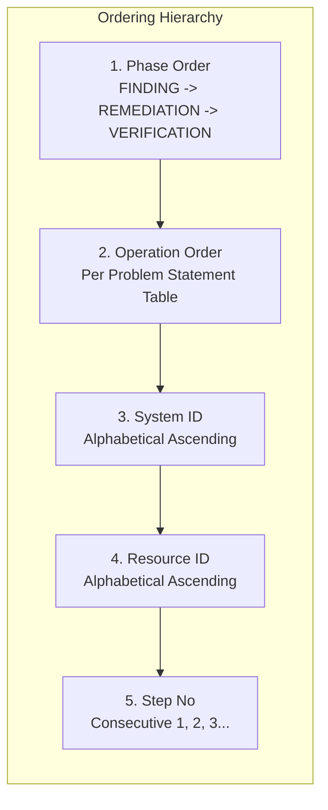

# Forensic Deletion Audit Engine — System Architecture

## 1. Executive Architecture Summary
The **Ghost Data Still Exists** forensic deletion audit engine is designed to audit distributed enterprise infrastructure (relational databases, document stores, object storage, distributed logging, cache layers, search indexes, and backup pipelines) for compliance with right-to-be-forgotten deletion requests under GDPR Article 17 and CCPA Section 1798.105.

The system determines whether personal data for a requested user has truly been eliminated or if "ghost data" persists. It produces deterministic findings, creates remediation steps for non-compliant systems, and provides verification checks for compliant systems according to `deletion_rules.csv`.

```mermaid
graph TD
    A[Deletion Requests<br/>518 Cases] --> B[Request Classifier<br/>is_deletion Intent Engine]
    B -->|Non-Deletion / Portability| C[NOT_APPLICABLE<br/>steps_json = []]
    B -->|Valid Deletion Request| D[Identity Graph Engine<br/>Bi-Temporal Token Mapping]
    
    E[Evidence Multi-Format Ingester<br/>SQL, JSON, Syslog, PDF, OCR] --> F[Observation Index<br/>(rid, state, ts, fts, toks)]
    G[System Activity Logs<br/>system_activity.csv] --> H[Activity & Batch Reconstructor]
    
    D --> I[Audit Reconstruction Engine]
    F --> I
    H --> I
    J[Policy & Retention Rules<br/>deletion_rules.csv] --> I
    
    I --> K{Audit Evaluation<br/>at audit_at}
    K -->|Any Non-Compliant Ghost Data| L[INCOMPLETE Case<br/>FINDING -> REMEDIATION -> VERIFICATION]
    K -->|All Required Systems Compliant| M[COMPLETE Case<br/>VERIFICATION Only]
    
    L --> N[Canonical Step Formatter & Sorter]
    M --> N
    C --> O[Output Formatter<br/>RFC 4180 CSV Writer]
    N --> O
    O --> P[output.csv<br/>518 Validated Rows]
    P --> Q[Independent Submission Validator<br/>validate_submission.py]
```

---

## 2. Core Subsystems

### 2.1 Identity Resolution Engine (`ghost_audit.identity` & `ghost.identity_graph`)
Enterprise users evolve identifiers over time (changing primary emails, updating phone numbers, resetting credentials, or using secondary aliases). A naive lookup on the request email misses ghost data stored under historical or hashed identifiers.

#### Key Architectural Capabilities:
1. **Bi-Temporal Interval Tracking**:
   - Each token (normalized email, SHA-256 email digest, E.164 phone number, account ID, user UUID) is modeled as a time-bounded interval: `(user_id, valid_from, valid_to)`.
   - Built by traversing `user_audit_log.csv` and `user_identities.csv`.
2. **Contamination Guard**:
   - In distributed systems, identifiers can occasionally be reassigned or shared (e.g., VoIP numbers or enterprise team emails).
   - If a token is claimed by multiple users, the engine marks it ambiguous and attributes it **only** to the user whose ownership interval covers the evidence observation timestamp `ts`. If unassigned or out-of-bounds, it is safely dropped to avoid false-positive attribution.
3. **Multi-Representation Token Expansion**:
   - Every email generates its canonical lowercased representation, trimmed variant, and standard SHA-256 hexadecimal hash, ensuring cross-system correlation with anonymized analytics caches.

---

### 2.2 Multi-Format Evidence Ingestion (`ghost_audit.evidence`)
Enterprise evidence arrives in diverse raw formats. The ingestion pipeline converts heterogenous artifacts into normalized forensic observations without loss of fidelity.

```
Observation Tuple:
(evidence_id, system_id, resource_id, state, timestamp, file_timestamp, tokens)
```

#### Supported Evidence Modalities:
1. **SQL Database Dumps (PostgreSQL / MySQL)**:
   - Streaming SQL tokenizer parses `INSERT INTO` statements, extracting column schemas, row tuples, primary keys, timestamps, and column-level PII tokens.
2. **JSON Bundles & JSONL Streams**:
   - Ingests structured customer data snapshot bundles, user profile snapshots, and nested event streams.
3. **Structured & Syslog Operational Logs**:
   - Handles standard space-delimited syslog headers and leading-pipe syslog lines (`| DEBUG | ...`).
   - Extracts trace identifiers, source/target systems, resource references, and operational results (`200 OK`, `404 NOT FOUND`, `FAILED`, `SUCCESS`).
4. **Binary Documents & PDF Support Attachment Ingestion**:
   - Native Python document parser (`pypdf`) extracts textual payloads from customer support PDF uploads, driver license verifications, and signed billing receipts.
   - Binds OCR-free document tokens directly to resource IDs (`support_attachment_*`), ensuring proper classification under `SUPPORT_ATTACHMENT` policy rules.
5. **Race Condition & 404 Suppression Guard**:
   - Distributed lookups often emit pairs: `profile_lookup_started` followed by `profile_lookup_completed [status=404, rows=0]`.
   - The engine automatically suppresses emitting false `FOUND` observations from `_started` lines when a corresponding outcome line exists within the same operational trace.

---

### 2.3 Policy & Retention Engine (`ghost_audit.policy`)
Encodes statutory and infrastructure rules derived from `deletion_rules.csv`:
- **Allowed Identifiers**: Full PII, Hashed Identifiers, Tombstone only, or None.
- **Allowed States**: Differentiates between non-compliant active states (`IDENTIFIABLE`, `ACTIVE`, `FOUND`, `PRESENT`) and legally compliant states (`ANONYMIZED`, `REDACTED`, `BLOCKED`, `ABSENT`).
- **Grace Periods & Legal Hold**: Security audit logs (`security_service`) retain compliance records under statutory retention policies, requiring verification of `PRESENT` rather than deletion.

---

### 2.4 Forensic Audit Engine (`ghost_audit.engine`)
The core orchestrator evaluates the system state at timestamp `audit_at`:

1. **Request Intent Classification**:
   - Evaluates whether the request is a valid erasure request under GDPR Art. 17 or an access / portability request (e.g., requesting a downloadable data export or asking questions about privacy policy).
   - Non-deletion requests are deterministically flagged `NOT_APPLICABLE` with `steps_json = []`.
2. **Temporal State Evaluation (`state_at`)**:
   - Evaluates evidence strictly captured at or before `audit_at`.
   - Implements safe fallback ranking: prioritizes evidence snapshots where snapshot file time `fts <= audit_at`. If subsequent snapshot files are captured after `audit_at`, records observed within the operational window `<= audit_at` are indexed without temporal leakage.
3. **Activity Timeline & Batch Reconstructor**:
   - Reconstructs background deletion worker execution traces from `system_activity.csv`.
   - Links batch deletion requests to background activities through strict temporal proximity and rank alignment within shared batch timestamps.

---

## 3. Step Generation & Canonical Ordering

The output contract mandates strict ordering across phases and operations. Steps are sorted according to a deterministic hierarchy:



### Operation Order Mapping:
| Phase | Operation Rank | Operation Name |
|---|---|---|
| **FINDING** | 1 | `REPORT_REMAINING_RECORD` |
| | 2 | `REPORT_UNREDACTED_RECORD` |
| | 3 | `REPORT_UNANONYMIZED_RECORD` |
| **REMEDIATION** | 1 | `DELETE_RECORD` |
| | 2 | `REDACT_RECORD` |
| | 3 | `ANONYMIZE_RECORD` |
| **VERIFICATION** | 1 | `VERIFY_RECORD_ABSENT` |
| | 2 | `VERIFY_RECORD_PRESENT` |
| | 3 | `VERIFY_RECORD_REDACTED` |
| | 4 | `VERIFY_RECORD_ANONYMIZED` |

---

## 4. Independent Submission Validator (`validate_submission.py`)

To ensure zero submission defects, the validator operates independently of the audit engine:
- **Zero Hallucination Validation**: Verifies that every `evidence_id` cited in a `FINDING` or `COMPLETE` case exists in `dataset/evidence_files.csv`.
- **Structural Integrity**: Enforces valid JSON schema, non-empty fields, exactly 518 data rows matching `dataset/deletion_requests.csv` in identical case order.
- **Phase Isolation**: Verifies that `REMEDIATION` and incomplete `VERIFICATION` steps never cite an `evidence_id` (empty string `""`).
- **Strict Monotonicity**: Verifies that `step_no` starts at 1 and increases by exactly 1 per step.

---

## 5. Performance and Determinism Guarantees
- **Runtime LLM Invocations**: 0 (100% deterministic rules, regex, and relational graph reconstruction).
- **Execution Cost**: $0.00.
- **Full Run Latency**: ~10–12 seconds across all 518 cases and 94 multi-format evidence archives.
- **Memory Footprint**: Under 250 MB peak memory.
